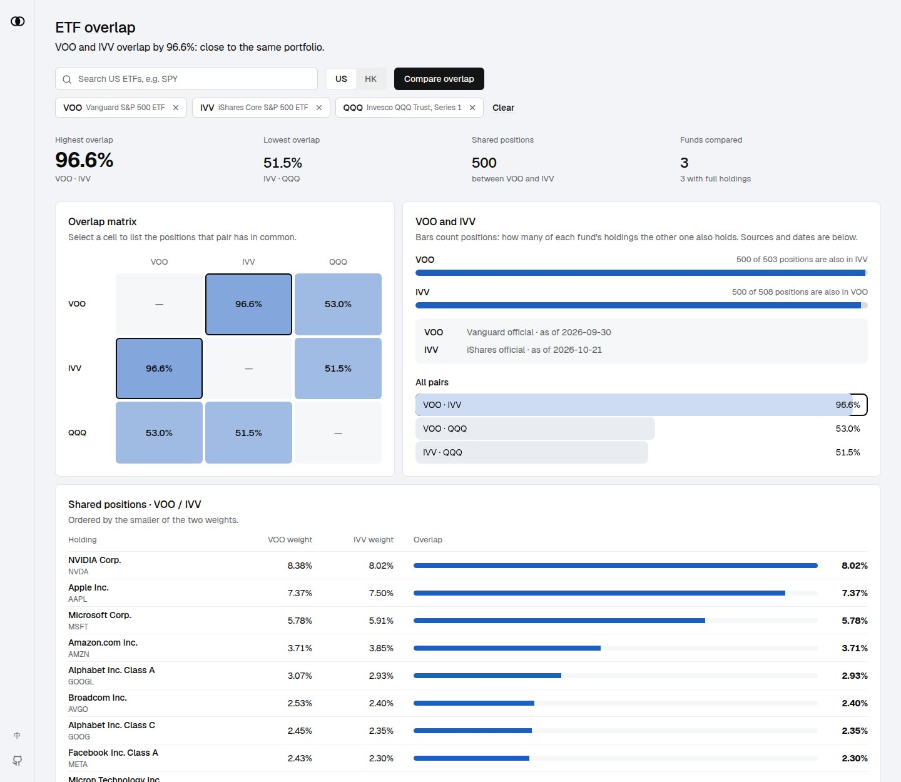

# ETF Overlap Calculator

[https://etf.domc.me/](https://etf.domc.me/)

这是一个用于分析和计算不同 ETF（交易所交易基金）之间持仓重叠度的工具。帮助投资者了解不同 ETF 组合的真实分散程度，避免因持仓重复而导致的风险集中。

## 主要功能

### 1. ETF 搜索

- 支持通过代码（Symbol）或名称搜索全球市场的 ETF。
- 基于 Yahoo Finance 数据源，覆盖广泛。

### 2. 持仓分析

- 获取 ETF 的**完整持仓**，按以下优先级取数：
  1. 发行商官方每日持仓文件：iShares、Vanguard、SPDR (State Street)、Invesco
  2. SEC N-PORT 申报（免费，覆盖所有美国注册 ETF，但按季度披露，有数月延迟）
  3. Yahoo Finance 前 10 大持仓（兜底）
- 无法获取完整持仓时，页面会显示橙色提示并标注原因；每只 ETF 都标注数据来源和截止日期。
- 可通过环境变量 `SEC_USER_AGENT`（格式 `name email`）自定义访问 SEC 时的 User-Agent。
- 显示每个持仓股的名称、代码及权重占比。

### 3. 重叠度计算 (Overlap Analysis)

- **重叠权重计算**：计算两个 ETF 之间在相同持仓上的权重重叠总和。
  - 例如：如果 ETF A 持有 5% 的 NVDA，ETF B 持有 3% 的 NVDA，则这部分的重叠为 3%。
- **重叠矩阵**：通过矩阵视图直观展示多个 ETF 两两之间的重叠程度。

### 4. 详细对比

- 点击重叠矩阵中的单元格，可以查看具体的共同持仓明细。
- 列出共同持有的股票及其在各自 ETF 中的具体权重。

## 技术栈

- **前端**: React, TypeScript, Tailwind CSS
- **构建工具**: Vite
- **后端/API**: Node.js, Express (适配 Vercel Serverless Functions)
- **数据源**: 发行商持仓文件、SEC EDGAR N-PORT、Yahoo Finance (yahoo-finance2，搜索与兜底)
